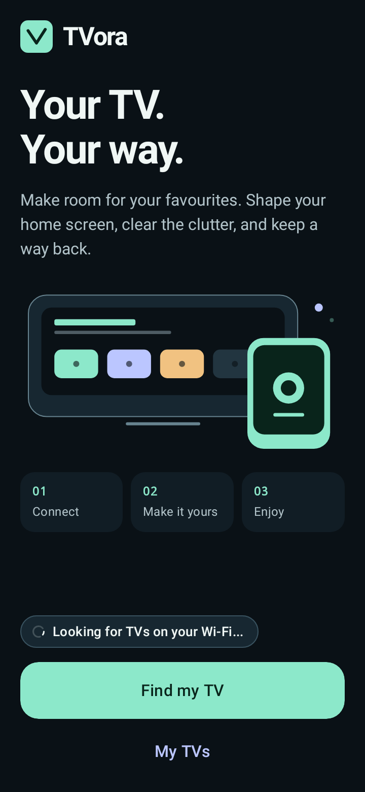
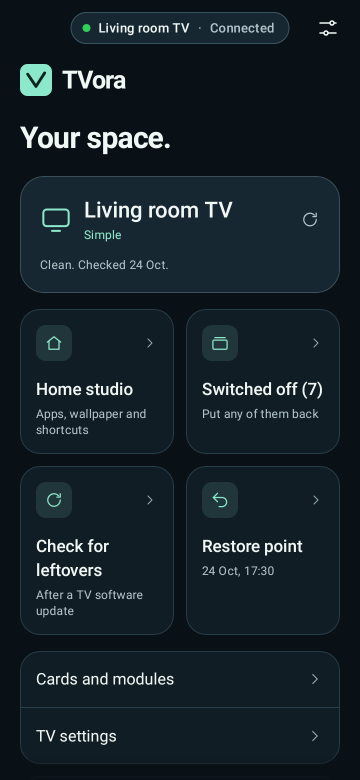
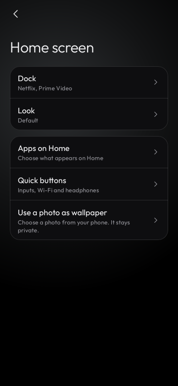

<p align="center"></p>
<h1 align="center">TVora</h1>
<p align="center"><strong>Your TV. Your way.</strong><br>Clean up and personalise your Android TV from your phone.</p>

<p align="center">
  <a href="https://github.com/Techyeye98/TVora/releases/latest/download/TVora-v0.1.0.apk"></a>
</p>
<p align="center"><strong><a href="https://github.com/Techyeye98/TVora/releases/latest/download/TVora-v0.1.0.apk">Download APK directly</a></strong> · <a href="https://github.com/Techyeye98/TVora/releases/latest">Release notes</a><br>Free · Android 9+ phone · No account or subscription needed</p>

**New to GitHub?** Tap **Download TVora APK** above on your Android phone. Open the downloaded
APK and, if Android asks, allow installation from your browser or file manager. Install TVora,
then connect your phone and TV to the same Wi-Fi. You do not need a GitHub account.

Used on the maintainer's Mi TV, with positive feedback from users on their setups.
See the setup instructions below to get started.

TVora helps you choose the apps you see, arrange your Home screen, add your own wallpaper and
reduce TV clutter with a recovery path. No ChatGPT account, coding agent or subscription is needed
to run the app. TV permissions and debugging authorization are always granted by the owner.

## Make it yours

- **Home screen:** select apps and arrange the dock and the rows below it.
- **Show or hide apps:** change Home visibility without uninstalling an app. Showing an app again
  restores its saved place, unless you changed its saved order in between.
- **Your wallpaper:** choose a photo from your phone. TVora makes a bounded, metadata-stripped JPEG
  copy, with camera orientation handled, and sends it only to your selected TV.
- **Quick buttons:** Inputs, Wi-Fi, Bluetooth headphones and remote app arrangement; Settings remains accessible.
- **Arrange from the TV:** open the arrows button beside Settings. OK picks up an app, arrows move
  it, Back places it, and Back again saves and finishes. Extra app rows scroll below the dock;
  adding or moving apps preserves the chosen theme's title and spacing below the clock.
- **Cleanup with recovery:** review the plan, save a restore point, disable supported packages and
  put them back individually or restore the supported previous setup.
- **Connect from the phone:** legacy network ADB and experimental pairing-code/TLS support.
- **Interface:** preserves the upstream Outfit typography, glass surfaces, ambient glow,
  animated TV illustration and interaction motion. TVora's extra controls use the same list rows
  and sheets. TVora's text-free icon is a closed glass TV with two feet and a soft glow.

The bundled TV launcher retains the original black background and app-colour glow by default.
Changing the phone app's appearance does not change a TV until its owner applies a setting.

## Screens

<p align="center">
  
  
  
</p>

Screenshots in `docs/screenshots` are captured from the actual Compose UI with Robolectric, not
marketing mockups. Appearance can vary with your phone and TV.

## Try it

Use an Android 9+ phone and a supported Android/Google TV on the same trusted Wi-Fi network.
Enable TV debugging, select the TV and approve the phone on the TV. For modern Wireless debugging,
use the TV's six-digit pairing code, pairing port and its separate connection port.

Review the plan before **Make it clean**. Use **Home screen** for appearance and app placement.
For an existing TV, after updating TVora open **Home screen → Quick buttons**, leave
**Arrange apps on TV** on and tap **Done**. This sends the new button and reapplies the theme's
dock spacing. More apps remain below the dock and are reached with Down on the remote.
Save a copy of the recovery scripts outside the app. Finish closes debugging unless you chose
to keep it on; enable it again for a later management session.

Some TVs support cleanup only and keep their own launcher. Manufacturer, firmware and Android
version determine the available features.
Samsung Tizen and LG webOS are not supported.

## Build

JDK 21, Android SDK platform 37 and build tools 36 are required. The modified launcher source is
vendored under `third_party/cleanyourtv`; this checkout needs no private upstream signing key and
no Git submodule initialization to build the phone app.

```sh
./gradlew :core:ops:test :core:flows:test :adb:pairing:test checkModuleGraph
./gradlew :app:assembleFullDebug :app:lintFullDebug
```

Debug APK: `app/build/outputs/apk/full/debug/app-full-debug.apk`.
Application ID: `dev.tvora.app`. Code namespaces remain `tv.cleanyour.*` for maintainable upstream
integration; the installed app identity and public branding are TVora.

`assembleFullRelease` creates an optimized unsigned APK unless you configure your own signing.
Never commit signing keys. Local preview APKs use a development certificate and are not a store
release. TVora has no upstream app-update feed; its own update feed can be connected after the
repository and release signing policy are established.

The optional full build can install add-ons from the inherited signed index. The Play flavour
omits add-on downloads. Neither flavour turns off TV software updaters in this preview.

## Testing and compatibility

See [Restore verification](docs/RESTORE-VERIFICATION.md) for recovery coverage and limits.

TVora has been used on the maintainer's Mi TV, and users have reported successful use on their
setups. Automated checks cover core operations, state machines and recovery scenarios.

Modern pairing-code/TLS support remains experimental. A full restore-and-return test on the
maintainer's physical TV is still pending; automated restore verification is documented above.
The detailed protocol tests use an agreed-secret test double for PAKE; they do not validate the
native SPAKE2 exchange or Android Keystore on every device.

Focused TVora screenshots cover onboarding, dashboard, Home screen and large text. Older upstream
goldens remain as reference; they are not a visual baseline for the redesign. Record current
baselines on Linux before enabling a full screenshot-verification gate.

The universal release includes multiple ABIs for Conscrypt and native SPAKE2 and exceeds the
base project's 8 MB size budget. The inherited size-check task remains available; the preview
workflow does not claim that budget passes. Per-ABI distribution is a possible later optimization.

Profiles, account/cloud sync, setup sharing, character artwork and a general APK uploader are
outside this preview. Recovery is for supported settings and package states, not firmware, app data
or streaming-account backups. Imported photos are not included in recovery-script exports.

## Credits and license

TVora is an independent derivative of [Clean Your TV app](https://github.com/udhaykumarbala/cleanyourtv-app)
by udhaykumarbala, based on revision `a8e55aa`. Its launcher, themes and community TV lists come from
[Clean Your TV](https://github.com/Gathin23/cleanyourtv) by Gathin and contributors, pinned at
`3e34f40f42728284bbb3d4d7bea57c3f504c3b31`, with TVora's Bluetooth shortcut changes.
Those projects and their owners are credited; TVora does not imply their endorsement.

The app and launcher are MIT licensed; original notices are retained. Native SPAKE2 is LGPL-3.0,
Conscrypt and the adapted pairing cipher are Apache-2.0. See [THIRD-PARTY-NOTICES](THIRD-PARTY-NOTICES),
[LICENSE](LICENSE), and `third_party_sources` for corresponding pairing-library source archives.

See [PRIVACY.md](PRIVACY.md) for local data handling and [TV-STUDIO.md](TV-STUDIO.md) for the initial
implementation record. Download the current APK from [TVora releases](https://github.com/Techyeye98/TVora/releases/latest).
